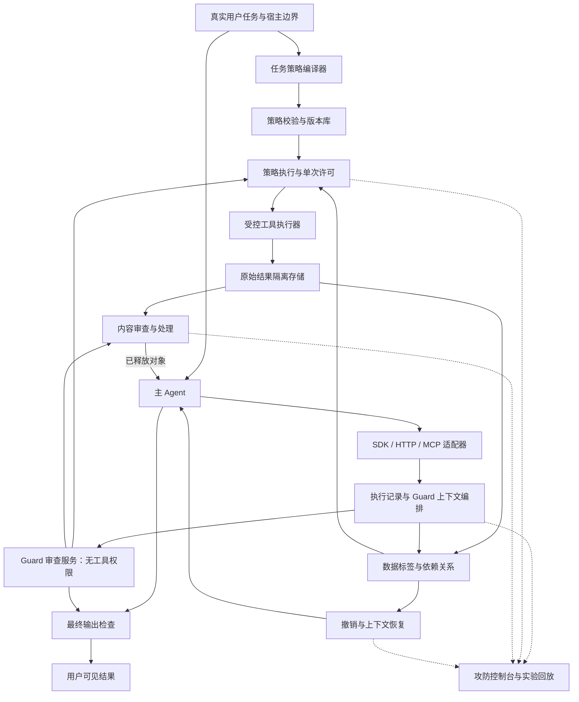

# AgentGuard v2 最终修改计划

日期：2026-10-21；调研与核稿：2026-10-20—21。性质：设计与实施基线。2026-10-22 双人提交已进行集成；当前完成度和验证结果见 [集成验收报告](v2/INTEGRATION_REVIEW_2026-10-22.md)，不能把下文计划全部理解为已实现。

适用条件：两名学生借助 AI 并行开发、Windows 开发环境、使用云端模型 API、无本地 GPU 前置要求。比赛截止时间与 API 预算未给定，以下按依赖和验收组织，不承诺未经测量的工期、费用或拦截率。

两人开工请先看 [双人并行开发总任务书](V2_TWO_PERSON_PLAN.md)，再分别领取 [A：安全运行时任务书](tasks/V2_A_RUNTIME.md) 和 [B：Guard 与应用任务书](tasks/V2_B_GUARD.md)。双方以 [共享接口约定](tasks/V2_SHARED_CONTRACT.md) 对接；本文件继续规定架构与验收底线，双人任务书规定分工与并行顺序。

## 1. 最终决定

将现有工具包装器升级为**面向长任务的 Agent 安全运行时**，提供 SDK 和独立网关。核心流程仍保持用户的设想：工具结果先进入没有工具权限的 Guard 审查，允许的内容才能进入主 Agent。

完整作品由四个子系统、八个主要模块组成：

| 子系统 | 模块 | 必须实际完成的工作 |
|---|---|---|
| 任务与接入 | ① 任务策略编译器 | 从用户任务生成本任务的结构化约束，程序验证并执行；不再依赖扫描场景硬编码 |
| 任务与接入 | ② 工具登记与适配器 | Python SDK、HTTP/MCP 接入；描述并核验工具的输入、资源、效果和输出 |
| 上下文与数据 | ③ 执行账本与上下文编排 | 记录真实事件、每轮模型输入与来源关系，为 Guard 组装相关证据 |
| 上下文与数据 | ④ 结果隔离与数据流约束 | 原始结果暂存、双标签传播、脱敏版本、受控数据引用 |
| 审查与执行 | ⑤ Guard 审查服务 | 内容、动作、最终输出三类审查；输出可定位证据与处理决定 |
| 审查与执行 | ⑥ 策略执行与单次许可 | 原子领取许可、绑定参数与版本、执行前重验、已知限制独立于模型执行 |
| 恢复与验证 | ⑦ 会话恢复 | 撤销受影响许可、重建上下文、保留真正独立的工作成果 |
| 恢复与验证 | ⑧ 攻防实验与可视化 | 显示策略、事件、数据关系、Guard 实际输入、处理前后差异与真实攻击效果 |

复杂度落实在并发、状态、来源、证据、策略变更与恢复上。部署先采用**模块化 Python 服务 + 工具执行进程 + Streamlit 界面**，不为模块数量额外建设八个微服务。

三个主要工程亮点：

1. **动态任务策略与受限更新**：任务可以变化，执行约束仍可由程序检查。
2. **按执行关系组织 Guard 上下文**：面向几十次工具调用，处理历史过长与跨步攻击。
3. **数据依赖、单次许可与恢复联动**：模型误判时仍约束已有明确限制，并提供可观测的续行过程。

这些是拟实现与验证的工程组合，不能直接称为原创理论。

## 2. 研究与开源取舍

本轮查阅原始论文、作者仓库和官方文档。以下区分“借鉴机制”“可能复用代码”和“直接依赖”；未安装或运行这些项目，因此兼容性和论文结果均未在本项目复现。

| 来源 | 采用的机制 | 使用方式与边界 |
|---|---|---|
| [Progent 论文 v3](https://arxiv.org/abs/2504.11703v3)、[作者仓库](https://github.com/sunblaze-ucb/progent) | 按任务生成策略、符号化工具参数约束、区分收紧和扩张 | 重点借鉴；作者仓库 MIT。首版自建有限策略表示，不承诺任意 JSON Schema/正则的包含关系可判定。论文与当前代码功能应分别核验 |
| [Fides 论文](https://arxiv.org/html/2505.23643v1)、[Microsoft 教程](https://github.com/microsoft/fides) | 保密性/完整性分离、模型输出继承输入限制、隐藏变量 | 重点借鉴；MIT 仓库是教程，不直接作为生产运行时。保守依赖与标签可信来源必须保留 |
| [CaMeL 论文](https://arxiv.org/html/2503.18813v2)、[研究代码](https://github.com/google-research/camel-prompt-injection) | 数据/控制隔离、数据能力约束、程序执行权限 | 作为设计参考与相关工作；Apache-2.0，作者明确不计划支持维护。首版不移植解释器，不继承其形式化保证 |
| [Invariant Guardrails](https://github.com/invariantlabs-ai/invariant)、[Gateway](https://github.com/invariantlabs-ai/invariant-gateway) | 轨迹级跨步规则、工具与模型入口的检查 | 借鉴事件和策略接口；两仓库 Apache-2.0。不整体替换现有程序，避免两套执行与策略框架 |
| [Blocking at the Boundary](https://arxiv.org/html/2610.05163v1) | 将动作字段与历史证据对应，程序检查引用是否存在 | 借鉴证据输出格式；2026 年 10 月预印本，未确认可依赖的作者代码。引用正确不证明语义归因正确，离线结果不等于线上防护效果 |
| [Minimizer + Sanitizer 研究](https://arxiv.org/abs/2510.05244)、[作者介绍](https://firewall-defenses.github.io/) | 减少工具输入范围、过滤工具返回内容 | 借鉴内容最小化，并作为强基线设计来源。其公开基准表现不能转写为本项目成绩 |
| [官方 MCP Python SDK](https://github.com/modelcontextprotocol/python-sdk) | 协议与连接基础 | 直接依赖，MIT；实施时锁定兼容的稳定版本，不依赖 main 的未来变化 |
| [AgentDojo](https://github.com/ethz-spylab/agentdojo)、[pipeline 接口](https://agentdojo.spylab.ai/concepts/agent_pipeline/) | 多步真实模型任务、工具返回注入、任务和攻击结果检查器 | 主要外部评测，MIT；固定 commit、任务集与模型设置，独立评测环境 |
| [InjecAgent](https://github.com/uiuc-kang-lab/InjecAgent) | 工具内容注入、两阶段窃取场景 | 辅助样例和审查回归，MIT；不能单独证明长任务有效 |

可选且不进入首版必需依赖：

- [LlamaFirewall](https://github.com/meta-llama/PurpleLlama/blob/main/LlamaFirewall/README.md)：借鉴扫描器接口或后续对照；其组件 LICENSE 为 MIT，但模型权重有各自条件，Torch/模型下载不作为云端版前置条件。
- [OPA](https://github.com/open-policy-agent/opa)、[agentgateway](https://agentgateway.dev/docs/standalone/latest/)、[NeMo Guardrails](https://github.com/NVIDIA-NeMo/Guardrails)：可作后续后端或部署适配。它们均有 Apache-2.0 项目许可，首版不同时引入多套策略语言和对话运行时。
- [AutoDojo](https://github.com/xhOwenMa/AutoDojo)：API 预算允许后做自适应攻击，在独立环境运行，避免与上游 AgentDojo 包混装。
- [PrivacyLens](https://github.com/SALT-NLP/PrivacyLens)：可补充没有明显注入文字的隐私泄露任务；代码 MIT，数据另有 CC BY 4.0 等归属要求，不能混用许可判断。

未来复制代码时记录项目 URL、commit、文件路径、原始许可、修改内容；保留许可证和必要归属。论文可借鉴不等于公开仓库中的任意文件都允许直接复制。

## 3. 总体架构与信任边界



Guard 是云端推理请求，不具备文件读取、浏览、终端、邮件或自主循环权限。任务策略生成、动作审查、内容审查可以使用同一模型的独立请求，不需要部署多个自主 Agent。

推理端点与模型由宿主固定配置，禁止工具内容更换端点、鉴权或提示模板。允许指定可信云端接收原文，仍需区分 Guard 模型与主 Agent 模型各自可接收的数据。API Key 保存在推理客户端，不写进提示词。

安全控制器和工具执行器属于可信程序。SDK 形态依赖宿主合作；独立网关也只有在后端凭证、网络和文件入口不被旁路访问时才是强制边界。首版威胁模型主要针对通过工具内容操纵模型，不声称已经抵御取得宿主任意代码执行权限的攻击者。

## 4. 用动态策略解决“写死规则不通用”

### 4.1 两层权限依据

宿主预先提供最大边界，例如工作目录、可用工具、批准的云端推理服务、外发目标管理方式。初始任务策略编译器读取**可信用户任务、宿主最大边界、资源登记表与经确认的工具定义**，生成本任务候选策略；不将工具正文中的授权声明当作这些输入。

示例：

```yaml
task_policy:
  task_version: task-1
  allowed_effects: [read, write]
  read_scopes: [project_docs, project_logs]
  write_scopes: [report_directory]
  external_destinations: []
  protected_data_uses: [analyze_locally, reply_to_user]
```

这只是语义示例；资源名必须由宿主资源登记表解析，不能把任意模型字符串直接当作真实路径。换成“把脱敏日志上传至用户指定诊断服务”的任务，候选策略可以包含受限发送动作和对应目标，不需要改核心代码。

程序校验候选策略是否在宿主最大边界内，再建立初始任务策略。模型误解任务并生成过宽的初始策略仍是风险；高影响动作继续进行任务关联审查，不能称初始策略生成完全可靠。

### 4.2 先实现有限、可比较的策略语言

首版支持：工具/效果枚举集合、登记资源集合、经过规范化的受控目录、精确主机与端口、允许数据用途、数量上限。对这些约束实现显式交集与收紧判断。

先不允许模型生成任意 Python/Rego/SQL，不以字符串执行规则。无法证明为收紧的更新按“可能扩张/无法判断”处理；对任意正则和自然语言权限范围，不声称可以自动验证包含关系。

模型可以提出策略收紧。涉及增加外发目标、扩大可读范围或增加高影响动作的更新，不因 Guard 自己说“有必要”而生效，必须来自真实用户/宿主授权接口。正常情况下在初始授权内按任务自动运行。

程序并非决定所有语义；它执行模型形成的有限策略，并阻止已确定的越界。Guard 对具体动作的语义判断仍有否决作用。来源可核验的任务引用也只证明文字存在，不证明模型理解正确。

## 5. 用执行记录解决“Guard 长任务上下文怎么组织”

持久对象采用 SQLite 表和不可变版本：

```text
TaskVersion / PolicyVersion / ToolManifest
ModelTurn / ContextSnapshot / ContextMember
ToolCall / ExecutionReceipt
Artifact / ArtifactVersion / DependencyEdge
ReviewDecision / EvidenceRef
ExecutionPermit / RecoveryCheckpoint
```

关键 ID 分别表达 session、turn、call、artifact version 和 policy version，禁止用一个全局 step 代替全部关联。

每次模型调用前，宿主提交它实际将看到的已释放内容集合；这一集合成为 ContextSnapshot。提示中的用户附件、检索片段、记忆内容也需要标记来源。无法接入模型调用入口的纯 MCP 模式只能提供部分防护，不宣传完整的上下文跟踪。

Guard 每次获得五部分材料：

1. 用户原始任务、授权版本、相关明确限制。
2. 当前完整动作参数或待审内容，连同其版本。
3. 当前输入对象的来源、敏感标签和允许用途。
4. 与此动作关联的执行记录、依赖祖先、未解决风险。
5. 有限的输出格式和本次证据编号。

检索先沿明确关系取数据，再补充全文检索。权限和风险不能因为向量 Top-K 未检索到就消失；首版使用 SQLite 查询与全文检索，无需向量库或图数据库。

一轮 20 个调用：批量登记、逐项授权、独立执行与暂存、逐项审查，完成后形成下一轮输入。异步完成顺序不作为因果顺序。写入同一资源和争用配额的操作串行或原子预留；独立只读操作可并发。首版使用批次等待点，后续才优化逐步释放。

内容审查和动作审查采用独立请求，避免不断重放整个攻击历史。超长材料采用有记录的分段与组合检查；缺少关键证据时隔离或返回信息不足，不能静默截断后放行。

## 6. 用可定位输出与隔离存储落实 Guard 的作用

任何工具结果都首先变成隔离对象。成功正文、错误、stderr、结构化字段、附件说明和资源内容经过统一入口，未审查原文不得先进入框架回调、消息历史、记忆或普通日志。

Guard 输出：

```json
{
  "decision": "REDACT",
  "finding_type": "instruction_in_tool_data",
  "affected_action_field": "upload.destination",
  "evidence_refs": [
    {"artifact_version": "a7-v1", "json_pointer": "/body/extra"}
  ],
  "redaction_targets": ["/body/extra"],
  "missing_evidence": [],
  "reason_code": "EXTERNAL_TEXT_CHANGES_DESTINATION"
}
```

对于非 JSON 文本使用原始版本中的字符范围。程序检查证据属于当前会话、版本存在、范围有效、改动类型受支持；禁止按模型输出执行代码。优先由程序按位置遮盖/删除，生成新版本；自由摘要需要另行检查并继承来源限制。

引用真实只表示证据存在，不能证明风险归因正确。Guard 判定也可能被注入；结构化格式不会自动解决语义攻击。

本任务需要审查的文本工具结果都经过内容审查。确定性扫描可提前拒绝已知问题，不能因“关键词未命中”跳过模型审查。动作入口对明确违规直接拒绝；低风险且被现有策略完整覆盖的动作可使用程序检查，高影响/异常动作调用 Guard。最终回复始终经过输出入口。

高风险或不确定样本可进行一次独立复核；不使用“多数模型同意就一定安全”的规则。复核仍无法确定时返回受限状态。每一阶段均记录原因和花费。

## 7. 用数据标签和引用补上程序的独立约束

每个对象分别记录：

- **完整性/来源**：内容来自真实用户任务、宿主记录，还是外部文件/网页。允许读取不等于允许服从。
- **保密性/允许用途**：可以进入哪个模型、能否交付给用户、能否送往某类工具或目标。

宿主元数据提供的标签具有独立依据。Guard 可识别未知秘密并建议增严，但不能单独取消已有的保护标签。若秘密没有可靠标签而检测器漏判，系统保障会受影响。

依赖分两类：

- `exact`：由程序观察到的复制、拼接、文件转换等明确依赖。
- `possible`：一次大模型输入对其全部输出的可能影响。

普通大模型输出保守继承该次输入的限制。不相信模型自述“没有使用这份秘密”。摘要、编码和文件改名不会自然清除限制；模型生成依赖图不能当作精确追踪。

为了控制误拦，对只需搬运、不需理解的文件或凭证使用 ArtifactRef。主 Agent 获得说明和引用，执行器在审查通过后读取不可变版本。引用绑定会话、对象版本、工具、允许用途和目标，不能在任意字符串位置自动兑换。未知引用拒绝。

需要分析原文时仍可以按策略释放，但相应上下文承担数据限制。用户要求保留的正常代码、命令、注入样本可以作为数据分析；它们不能改变任务授权。

脱敏需要明确允许降低哪些限制，避免“遮盖了密钥却仍不能释放任何正常字段”。首版区分**字段标签**与**文档整体标签**：对有已知结构的字段，由预先批准的程序转换完整遮盖/移除后，可以生成面向指定接收方的可释放视图，并只解除这些字段引入的相应限制。转换规则及其可降低的标签由宿主配置，Guard 只能指出待处理位置，不能自行授予降级权。

文档整体的保密标签不会因隐藏一个字段自动消失；LLM 摘要、任意改写、正则“看起来没匹配到秘密”也不能作为通用降级证明。新视图仍保存原始来源和外部内容的低可信标签。对无结构文本中的未知秘密，检测与处理效果仍需实验评估，无法验证必要条件时继续隔离。

## 8. 用执行状态机处理并发、重放与失败

执行许可至少绑定：

```text
session_id, turn_id, call_id, tool_manifest_version,
args_digest, artifact_versions, policy_version,
context_version, relevant_security_revision, expires_at
```

建议状态机：

```text
PROPOSED -> REVIEWED -> APPROVED -> CLAIMED -> SUCCEEDED
                                  |          FAILED_KNOWN
                                  |          UNKNOWN
                                  +-> REVOKED / EXPIRED
```

每张许可先在数据库事务中原子检查相关安全版本、撤销与有效期，并完成领取，再执行。还须对 `(session_id, call_id)` 建唯一执行约束，宿主重试使用稳定的幂等键，避免同一调用因重新审查获得两张许可后重复执行。两个执行器竞争同一调用，只允许一个进入工具；工具异常不会把许可恢复为未使用。

领取成功是授权提交点，执行器随后进入可能无法撤回的执行窗口。此后撤销可阻止未提交调用，不承诺终止已经开始的工具。进程崩溃或网络超时时，可能已经产生副作用却没有写入收据；这类状态标 UNKNOWN，先核实真实结果，不能因数据库缺少成功记录就自动重试非幂等操作。

执行前重新检查相关版本与撤销状态。文件路径不等于文件内容，涉及文件发送时使用不可变对象，或在受控执行器中核验并绑定实际读取的内容。参数摘要不能独自解决文件替换、DNS 变化和系统层竞争。

签名不是首要新增功能。同一网关内优先使用服务端随机许可 ID 和数据库状态，复用现有撤销概念；跨边界身份由认证通道和服务器状态保证。不为比赛重新发明凭据密码学。

最终答案需要显式 `finalize_output`；写报告、发信、上传等交付行为在对应工具动作前检查正文与目的地。首版最终回复完整缓冲后释放，避免流式内容已泄露才追加拒绝。

## 9. 恢复与继续任务

原文尚未释放时，隔离相应对象，其他独立结果正常处理。原文已经进入上下文后，依据 possible/exact 依赖标记可能受影响的后续对象，撤销未执行许可，再构造新的受控上下文。

恢复使用已批准材料与可信执行记录，不直接复制旧聊天历史。真正共享过同一模型上下文的输出可能全部受影响；不能只按文件名或 Agent 自报分支恢复。

恢复契约必须覆盖宿主与供应商保留的状态：创建新的模型会话，不复用旧 conversation/continuation 标识；冻结受影响的 Agent 记忆、框架 checkpoint 与工具缓存，并核查可能被污染的本地交付物。已写入外部世界的内容记录实际状态，不自动当作可信资料重新摄入。没有这些宿主钩子的适配器标记“不支持完整上下文恢复”，不提供名义上的恢复成功。

先实现：结果局部隔离、待执行调用撤销、单会话上下文重建。再实现：分离上下文的并行分支恢复。局部文件快照可用于恢复测试文件，但不能撤回邮件、网络外传或任意数据库副作用。

上下文重建解除的是本次输入暴露造成的运行条件，不自动扩大任务策略。已收紧策略的扩张仍走授权入口。

## 10. 接入范围与技术栈

### 10.1 首版范围

| 接入 | 实现要求 | 对外说明 |
|---|---|---|
| Python SDK | 同步/异步包装、模型输入登记、最终输出提交 | 最完整功能；宿主合作模式 |
| HTTP Gateway | 统一请求、内容提交、查询状态、输出提交接口；网关掌握工具凭证 | 强制性取决于后台入口与凭证隔离 |
| MCP Gateway | 首版固定版本的工具列表/调用，登记工具定义，检查结果和错误 | 仅覆盖声明支持的协议面；其他能力明确拒绝或单独适配 |
| 主 Agent 框架适配 | 自有演示 Agent + 一个常用工具调用框架 | 两种接入跑同一组策略，验证通用性 |

MCP annotations 不是可靠权限证明，需要接入者确认真实效果。[官方说明](https://blog.modelcontextprotocol.io/posts/2026-03-16-tool-annotations/)

纯 MCP 代理通常看不到最终回答和全部模型输入，因此完整模式必须配合宿主钩子。MCP sampling、未知资源协议、未经检查的 prompts 和附件类型不默认透明转发。

第一批工具覆盖文件读取、网页获取、隔离目录写报告、向本地测试端发送内容；第二批补充只读数据库查询和受限命令执行。适配器声明真实输入输出与效果，未知工具默认不支持。

任意 shell/Python 执行不能靠工具参数正则完整分析。需要这类能力时增加受控 worker；Windows 原生开发版和 Linux 隔离部署版分别声明能力，不宣传未验证的 OS 沙箱保证。

### 10.2 技术栈决定

- Python 3.12 为 v2 开发与验收目标；v2 发行时将 `requires-python` 明确设为 `>=3.12`，旧 1.1.1 版本的兼容声明保持独立，不声称新功能已验证 Python 3.10。FastAPI/Pydantic 用于网关与结构校验，HTTPX 或现有客户端连接云端模型。
- SQLite 存事件、版本、许可与关系；原始内容与普通审计分离。原始内容访问受限、可配置过期清理，敏感证据不默认进入 UI。
- 官方 MCP Python SDK，固定稳定版本和协议面；开发开始时实际安装验收。
- 复用 Streamlit，先实现事件时间线和关系图，不另做前端平台。
- 模型服务配置可替换；主要对照和消融固定一个主模型与 Guard 配置。第二个主模型先只跑小规模接入冒烟，验证接口可替换；预算允许再扩展实验，不宣称小规模接入证明跨模型鲁棒性。
- OTel、OPA、图数据库、向量库、分布式队列、GPU 分类模型均不作为首版前提。
- Docker/WSL2/Linux worker 是后续隔离部署配置，需独立验收。gVisor 不作为 Windows 原生必备。[平台要求](https://gvisor.dev/docs/user_guide/install/)

## 11. 旧代码如何迁移

当前仓库 1.1.1 的验收记录报告过 108 项测试通过；本轮只读核查，未重新运行。历史 DEMO 结果不代表新架构。

| 当前文件/机制 | 迁移操作 |
|---|---|
| `sdk.py` 的 ToolSpec、参数绑定、同步/异步包装 | 复用；执行逻辑转交新运行时，增加工具效果与版本信息 |
| `sdk.py` 执行后原样返回值 | 替换为隔离、审查、处理、释放；覆盖异常和回调旁路 |
| `sdk.py` 的共享 `_step` | 替换为不可变 call/turn/context ID；修复 await 后来源错绑风险 |
| `capability.py` 的 check → execute → consume | 改为原子 claim → execute → receipt；失败不返还许可，未知状态明确记录 |
| `capability.py` 的 TTL/撤销/参数谓词 | 复用概念与通过审查的实现，增加参数、数据与策略版本绑定 |
| `action.py` 固定工具名分支 | 改为 ToolAdapter 注册表；已有解析器作为内置适配器 |
| `baseline.py` | 抽离宿主最大边界与任务策略，不再绑定 sandbox 路径 |
| `taint.py` 单布尔污染与清洗即复位 | 新内核替换为对象标签、ContextSnapshot 与依赖关系；旧实现保留为历史对照 |
| `intent.py` 的词表/Thought 相似度 | 可保留为廉价信号与旧基线，退出通用判断核心 |
| `agent.py` 的 transcript 与 FINISH | 接入模型输入登记和最终输出提交；支持一轮多工具调用 |
| `guard.py`/`runtime.py` 的真实执行记录 | 迁入统一事件账本，保留 effects_complete/UNKNOWN 思路 |
| `app.py` | 分拆视图；同屏展示策略、Guard 输入、处理结果和真实效果 |
| `evaluation.py`、测试与沙箱 | 保留独立正常任务标签和受控工具，增加真实外发接收器、状态故障测试 |
| README、CLAIMS、DEMO 数据 | 新旧结果分目录；清理“零误报”“不可绕过”等超出证据的表述，保留原始历史数据 |

新内核先放在 `agentguard/v2/`，避免与当前 `runtime.py` 等模块重名，也方便旧版比较：

```text
agentguard/v2/
  contracts.py
  policy/       compiler.py, validator.py, engine.py
  state/        store.py, artifacts.py, lineage.py
  review/       context.py, reviewers.py, clients.py, budget.py
  execution/    permits.py, executor.py, batch.py
  recovery/     checkpoints.py
  adapters/     python.py, mcp.py, framework.py
  gateway/      app.py
ui/v2/
benchmarks/v2/
tests/v2/
```

旧 `agentguard.AgentGuard` 接口先保留，v2 显式导入并完成契约测试后再考虑默认切换。新增子包时补齐 `__init__.py`，将 `pyproject.toml` 的显式 `packages = ["agentguard"]` 改为限定 `agentguard`、`agentguard.*` 的包发现，避免把 libs/tests/ui 收进安装包；提示模板、默认策略和 Schema 显式声明包内资源。源码目录外安装 wheel 后验证资源加载与接口。

## 12. 实施里程碑与验收

每个里程碑形成一个可运行、可测试的交付。M0—M7 表示能力依赖，不要求两人串行开发；双人执行顺序见 [并行阶段表](V2_TWO_PERSON_PLAN.md)。双方用模拟组件先行开发，以共享 Schema 和契约测试约束接口。

| 阶段 | 工作与交付 | 完成标准 |
|---|---|---|
| M0：基线与契约 | 固定旧版本、运行已有回归；建立 v2 Schema、SQLite 事件记录、调用 ID、原子领取许可最小版及模拟工具 | 能准确区分批准、已执行、结果未知、已释放；并发事件不会错绑，同一许可不能重复进入模拟工具；旧版对照可运行 |
| M1：任务策略 | 通用云端客户端、模型生成候选策略、有限策略语言、宿主边界校验、版本与收紧判断 | 对人工预先定义的任务/期望权限矩阵进行独立比较；同一工具在不同任务下范围相符；非法规则和越权扩张不能自动生效 |
| M2：结果审查闭环 | 隔离存储、Guard 客户端、可定位证据、脱敏新版本、统一释放 | 未审查原文不会进入模型输入；超时/格式错误保持隔离；合法资料能用于完成任务 |
| M3：长任务上下文 | ContextSnapshot、精确/可能依赖、相关证据组装、批次调度、数据引用 | 20 个并行读取逐项关联；10/30/60 步轨迹可回溯；已知限制不会因历史压缩消失 |
| M4：执行与输出完整闭环 | 完善 M0 许可的参数/对象/相关版本绑定、执行前重验、数据用途检查、最终输出提交 | 竞争同一许可只调度一次；参数/对象/权限变化使旧许可失效；Guard 一律允许仍不能覆盖宿主预置限制 |
| M5：通用接入 | Python SDK、HTTP/MCP 网关、自有 Agent 与一个框架适配；安装包 | 同一策略通过两种接入执行；声明的入口均覆盖；源码目录外安装和调用通过 |
| M6：恢复与控制台 | 结果局部隔离、上下文重建、许可撤销、交互式事件与来源图 | 攻击样本出现后正常部分可继续；晚发现风险时正确扩大恢复范围；不可逆效果诚实展示 |
| M7：比赛验收 | 外部基准、对照/消融、成本与延迟报告、一键启动、演示材料；自适应攻击按预算追加 | 每项展示都有可复现证据；API 实跑与脚本回放分开；来源归属完整；明确哪些可选实验未运行 |

M0—M4 是技术闭环，M5—M7 是比赛交付所必需。先把全部八模块做成较小但真实的版本，再增加同类能力。高级 SMT 后端、多模态、多个操作系统沙箱、复杂分布式调度列为后续增强。

首批开发任务应具体到：

1. 冻结 ToolCall/Artifact/ReviewDecision/Permit/Receipt Schema，并给典型成功、拒绝、未知案例各一份 fixture。
2. 实现 SQLite 事件记录和单次许可事务，用模拟外发工具验证并发与异常。
3. 建立通用云端客户端与有限策略引擎，先用固定候选策略验证权限矩阵，再接入任务策略生成。
4. 实现 ArtifactStore 与 release 门禁，用模拟 Guard 验证原文不会提前进入模型，再接入云端结构化内容审查。
5. 按里程碑补全上下文、数据关系和适配器，避免先重写全部 UI。

按 M0 → M1 → M2 推进早期纵向样例；M0 的许可是最小版本，M3 形成数据关系后由 M4 加入完整的版本绑定与用途校验。进入真实副作用测试前必须具备许可和隔离基础。

## 13. 云端 API 成本与性能

默认使用一个主模型配置和一个 Guard 配置，Guard 的不同职责复用客户端，使用独立提示和响应 Schema。无需本地训练或下载大模型。

计费控制：

- 记录每阶段输入/输出 token、模型、时延与重试次数。价格通过配置填写并标记日期，不把当前价格写死。
- 先用 8 个正常任务和 8 个攻击任务测单任务成本，再按预算确定评测规模。正式评测前固定任务清单、重复次数和总额度。
- 审查独立结果可并发，但设置请求数、超时、重试和 token 上限，遵守 API 限流。
- 使用内容与任务/策略/模型版本等完整键缓存分析结果；不能复用旧执行许可。缓存按会话/主体隔离，权限和相关安全状态变化时重新检查。
- 不确定样本才追加一次复核，避免每步固定调用多名“审判 Agent”。
- 分段摘要保留证据引用；不能为了节省 token 删除未决风险或丢弃权限信息。
- 预算用尽时进入明确受限状态，不跳过防护继续执行。

分析结果缓存不等于缓存授权。模型温度降低也不提供确定性安全保证。

## 14. 评测方案与成功标准

### 14.1 对照组

固定主模型、任务、工具环境和采样设置，比较：

1. 无防护。
2. 旧版 1.1.1/固定权限防护。
3. 普通双模型审查：任务与历史交给 Guard，输出允许/拒绝。
4. 最终 v2：动态策略、上下文证据、结果隔离、来源约束、许可和恢复。

旧版只支持部分演示工具，不得把“未知工具全部拒绝”统计为防护成功。旧版结果限定在共同支持的任务/工具子集；若为其新增同语义适配器，作为单独注明的“旧规则＋统一适配”基线，不能冒称原始 1.1.1。外部完整任务集另报告无防护、普通双模型与 v2，缺失对照不填造分数。

前后系统改变模型可见内容本身就是防护处理，不声称轨迹完全相同。真实模型端到端实验与固定轨迹执行回放分开报告。

消融至少包含：全历史/最近若干条/相关证据上下文；有无数据限制传播；有无结果处理；全局冻结/上下文恢复。若复杂模块未改善安全、效用或成本，记录结果并调整，不能只保留有利样例。

### 14.2 样本

- 外部任务：AgentDojo 的选定任务集，官方任务完成和攻击完成检查器。
- 本地任务：代码/日志分析、文档报告、只读数据分析三类；每类均有正常与注入版本。
- 长任务：10/30/60 步，并发 1/5/20；早期植入延迟触发、文件更名与摘要后外发。
- 攻击类型：角色冒充、间接诱导、工具描述篡改、编码/分段载荷、Guard 误导、目标替换、日志/错误泄漏、未知工具。
- 预算允许时加入自适应攻击，并固定攻击者可见反馈、尝试次数与成本。

留出任务和攻击措辞不参与提示词调试。报告样本分母、重复次数和区间；效果未知不算防护成功。

### 14.3 必须通过的程序约束测试

- 模拟 Guard 一律返回 ALLOW，宿主预置的资源/数据限制仍生效；测试不能先让同一个 Guard 生成标签，再把该标签作为独立保障依据。
- 两个并发执行器领取同一许可，或同一 call_id 因重试获得不同许可，真实工具调用均至多一次；版本检查和领取在同一授权事务中完成。
- 审查后替换参数、对象内容版本、工具定义或相关策略，拒绝旧许可。
- 工具产生副作用后抛异常或进程在收据写入前崩溃，不因缺少成功记录重复执行；不确定的外发标 UNKNOWN。
- Guard 超时、返回畸形 JSON、引用不存在证据，原文仍未释放。
- 多次回调/乱序完成按调用编号归并，不串会话、不串轮次；恢复时不继续旧模型服务端会话或自动载入受影响的记忆/checkpoint。
- 私密原文不进入普通日志、提前发出的流式内容或模型缓存旁路。
- 未知类型、未知效果和未覆盖协议面有明确受限行为。

### 14.4 核心指标

正常任务成功率、受攻击任务成功率、攻击目标真实达成率、正常任务误拦率、未审查内容释放次数、受限数据实际外发次数、恢复后完成率、重做调用数、p50/p95 额外延迟、每任务 Guard 调用数/token/费用。

本地测试接收器直接确认假秘密是否到达；Guard 自己的“已阻断”解释不能作为攻击失败证据。程序约束用测试断言验收，模型效果以实测比较报告，不预设“99% 拦截”等数字。

## 15. 比赛界面与现场演示

控制台提供六个互相关联的视图：

1. **任务策略**：原任务、生成的约束、策略版本、收紧/扩张差异。
2. **执行时间线**：每次调用的提出、审查、领取、执行、结果审查、释放。
3. **Guard 审查材料**：实际发送的证据包与模型判定，私密值默认遮盖。
4. **内容前后对比**：原始假数据、处理位置、主 Agent 实际收到的版本。
5. **来源与恢复图**：文件 → 模型轮次 → 报告 → 外发，区分 exact/possible 边。
6. **真实效果与指标**：外发接收器、正常任务完成、API 花费、时延、失败与未知状态。

五个核心演示：

| 场景 | 展示重点 |
|---|---|
| 同一个上传工具，任务要求不同 | 动态策略不是固定工具黑名单 |
| 20 个读取中一份文档含注入 | 结果隔离与内容处理，正常任务继续 |
| 第 3 步读取受限资料，第 30 步摘要后外发 | 长任务上下文与数据来源约束 |
| Guard 被替换成“一律允许”，再替换已批准参数 | 程序独立约束与版本绑定 |
| API 超时、返回乱序、写入后异常 | 状态准确、失败受限、许可不可重用 |

现场提供真实 API 模式与清楚标注的录制/脚本回放模式。回放展示已保存执行事实或模拟工具效果，不冒充当前云端模型推理。数据均为演示假资料，独立运行不会触碰真实秘密。

## 16. 最终交付与声明

交付物：可安装 SDK、独立网关、两个 Agent 接入样例、四类首批工具、一键演示脚本、六视图控制台、对照与消融结果、故障测试、来源与许可证清单、架构与威胁模型说明。

这版计划以动态任务策略回应“规则写死”，以证据上下文回应“几十个调用怎么审”，以数据关系和许可回应“程序是否只听 Guard 的话”，以恢复和真实攻防结果体现工程完整度。

本轮只完成文献/代码核查和修改计划，没有安装第三方框架、调用付费模型或实现上述运行逻辑。开发时以里程碑验收为准，最终效果以实际运行结果为准。
