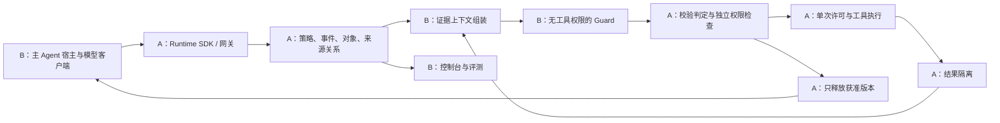

# AgentGuard v2 双人并行开发总任务书

日期：2026-10-21；状态更新：2026-10-22。双方提交已进行集成审查，代码尚未覆盖全部计划；具体已实现、部分完成和未开始项目见 [集成验收报告](v2/INTEGRATION_REVIEW_2026-10-22.md)。下文保留任务分工与验收要求，不因已提交而全部标为完成。

本任务书沿用 [v2 最终修改计划](V2_IMPLEMENTATION_PLAN.md) 的架构与验收要求，把实施顺序改成两人能够同时推进的两条工作线。没有比赛截止日，以下按交付阶段排期，不把阶段名称当成已经承诺的天数。

## 1. 分工结论与阅读顺序

| 人员 | 一句话职责 | 主要交付 | 独立开工的替代组件 |
|---|---|---|---|
| A：安全运行时负责人 | 让“允许、拒绝、隔离、执行、恢复”在程序里真正生效 | 策略校验、工具登记、SQLite 状态、数据隔离与标签、单次许可、批次执行、SDK/网关、恢复状态机 | 用固定策略生成器和 FakeReviewer 代替 B 的云端模型 |
| B：Guard 与应用负责人 | 让模型正确理解任务与证据，并证明整套系统有用 | 策略候选生成、Guard 审查、证据上下文、云端客户端、Agent 宿主接入、控制台、评测报告 | 用固定 ContextMaterial、FakeRuntime 和录制事件代替 A 的后端 |

这不是简单的“一个人写后台，一个人做页面”。A、B 都承担核心技术：A 负责可独立验证的执行约束，B 负责动态策略与长任务语义判断。界面和评测跟随主链路推进。

阅读顺序：

1. 两人先读本文件及 [共享接口约定](tasks/V2_SHARED_CONTRACT.md)。
2. A 按 [A 任务书](tasks/V2_A_RUNTIME.md) 开始；B 按 [B 任务书](tasks/V2_B_GUARD.md) 开始。
3. 架构理由、文献来源、完整威胁边界查阅 [实施基线](V2_IMPLEMENTATION_PLAN.md)，不必等全文反复讨论完才动手。

## 2. 两条线怎样合成一个系统

以读取文档为例：A 接住读取请求，B 判断其语义是否符合任务，A 检查硬约束后执行；返回原文先存进 A 的隔离区，B 审查原文并提出放行/脱敏/拦截，A 检查判定、执行获准变换，最后把已释放版本交回主 Agent。B 不能直接调用工具、修改权限或把隔离原文交回主 Agent。

“Guard 没有工具”指审查模型没有工具调用能力。B 写的上下文服务是普通程序，可以接收 A 提供的授权证据包；模型本身不能任意查询数据库、读文件或联网。使用可信云端 API 的原文传输仍是已授权的外部传输。

## 3. 文件归属：每个共享文件只有一个提交负责人

下表是计划新增的路径，除本次任务书外不表示文件已经存在。所有 v2 测试按负责人分目录，避免一起改一个大测试文件。

| 路径 / 文件 | 唯一修改负责人 | 说明 |
|---|---|---|
| `agentguard/v2/contracts.py`、`ports.py`、根 `__init__.py` | A | 公共模型与 Protocol；B 参与审阅，不能各维护一份 |
| `agentguard/v2/runtime.py`、`bootstrap.py`、`registry.py` | A | 主流程、依赖注入、宿主确认的工具清单 |
| `agentguard/v2/policy/validator.py`、`engine.py` | A | 候选校验、版本、约束包含关系、实际执行 |
| `agentguard/v2/policy/compiler.py`、`templates/` | B | 从任务生成有限格式的候选策略 |
| `agentguard/v2/state/`、`execution/` | A | 状态、对象、标签、来源关系、许可、工具与批次执行 |
| `agentguard/v2/review/` | B | 云端客户端、审查提示、上下文、预算和分析缓存 |
| `agentguard/v2/recovery/checkpoints.py` | A | 算受影响集合、撤销、恢复计划、恢复提交 |
| `agentguard/v2/adapters/python.py`、`mcp.py`、`gateway/` | A | 工具接入及 HTTP/MCP 边界 |
| `agentguard/v2/adapters/host.py`、`framework.py` | B | 自建 Agent、一个框架的模型输入/输出与恢复钩子 |
| `ui/v2/`、`examples/v2/`、`benchmarks/v2/` | B | 展示、两种宿主样例、假数据和独立评测 |
| `tests/v2/runtime/`、`tests/v2/contracts/`、`tests/v2/integration/` | A | 安全不变量、公共契约、实际连线与安装验证 |
| `tests/v2/guard/`、`tests/v2/host/` | B | 审查/策略/上下文、宿主不绕过和恢复测试 |
| `tests/v2/fixtures/` | B | 双方共用的纯假数据；字段变化先改公共契约 |
| `tools/v2/verify_runtime.ps1`、`pyproject.toml`、依赖锁定文件、根测试配置 | A | 可安装包与公共校验入口 |
| `tools/v2/verify_guard.ps1`、`start_v2.ps1`、`.env.v2.example` | B | Guard 校验、最终启动、无密钥配置样例 |
| `docs/tasks/V2_SHARED_CONTRACT.md`、`docs/V2_TWO_PERSON_PLAN.md` | A | 后续变更由双方确认、A 落文档 |
| A/B 各自任务书 | 各自负责人 | 更新状态、阻碍和验收证据 |
| `docs/V2_USER_GUIDE.md`、`docs/V2_EVALUATION.md`、`docs/V2_SOURCES.md` | B | 使用、实验、来源归属；A 补充部署边界供 B 整理 |
| `README.md`、`docs/V2_IMPLEMENTATION_PLAN.md` | A | 集成后统一更新入口和能力声明 |

嵌套目录的 `__init__.py` 跟随该目录负责人；`policy/`、`adapters/` 这类跨人目录的 `__init__.py` 由 A 维护，尽量保持空文件，避免循环导入。B 新增第三方依赖时给 A 提交名称、用途与兼容版本；由 A 统一修改项目元数据。

旧版 `agentguard/sdk.py`、`capability.py`、`taint.py`、`agent.py`、旧 UI 和旧测试先保留为对照。发现复用点时迁入 v2 的明确边界，不在旧入口上边重写边做对照实验。

## 4. 同时开工的阶段表

阶段是验收窗口，具体持续多久取决于两人的实现速度。每阶段结束做一次真实接口联调，失败时优先修复，不积攒到最后。

| 阶段 | A 同时做什么 | B 同时做什么 | 联合交付 / 放行条件 | 对应原里程碑 |
|---|---|---|---|---|
| S0：开工与契约 | A01：建立公共类型、最小 Runtime 外壳、FakeReviewer、旧版回归记录 | B01：准备共同 fixtures、FakeRuntime、FakeCloudClient、独立测试入口 | 一份请求/判定在两边解析结果一致；双方不接 API 也能运行 | M0 起步 |
| S1：最小安全闭环 | A02—A03：静态策略校验、隔离区、最小许可、释放门禁 | B02—B03：候选策略生成、单份内容审查、云端客户端；先在 fixtures 上调试 | 真实 B + 真实 A 跑通“一份正常文档、一份含注入文档”；错误/超时不释放 | M0—M2 |
| S2：长任务与完整执行 | A04—A05：版本绑定、原子执行、来源标签、批次屏障、最终输出门禁 | B04—B05：关系证据包、10/30/60 步轨迹、原生 Agent 宿主钩子 | 20 个并行读取不串号；早期受限资料不能在后期变换后越权外发；Guard 全允许仍受硬约束 | M3—M4 |
| S3：通用接入与恢复 | A06—A07：SDK/HTTP/MCP、网关部署边界、恢复计划与恢复提交 | B05—B06：一个框架适配、模型会话重置、六视图控制台 | 两个宿主用同一内核；实际恢复后继续任务；界面来自真实事件 | M5—M6 |
| S4：比赛交付 | A08：故障/竞争/安装回归、修复瓶颈、提供可复现实验入口 | B07—B08：基准、对照、消融、成本报告、一键演示与文档 | 五个演示可重跑，程序底线测试全过，模型效果有真实数据且标明限制 | M7 |

不能因为 B 的模型提示还在优化，就让 A 暂停原子许可和数据隔离；也不能因为 A 的数据库尚未完成，就让 B 暂停策略与上下文实验。

## 5. 第一轮就能做的具体任务

### 开工时一起用 30—60 分钟完成

1. 各领取 A/B 角色，读共享契约，确认 Python 3.12、版本化 JSON、UTC 时间和统一 ID 规则。
2. 选三个最小工具：`read_document`、`write_report`、`send_report`。内容全是假数据，`send_report` 只写本地测试接收器。
3. 确认第一条纵向任务：“阅读两份资料，在获准目录生成报告”；另一个任务明确允许向指定测试接收器发送，检验任务策略可以变化。
4. 固定契约版本 `0.1`。发现矛盾先在契约里改，不在各自模块偷偷补默认值。

### 接下来分别工作，不互相等待

**A 的第一轮产物：**公共类型与 Protocol；FakeReviewer；最小 SQLite 事件和许可记录；`read_document` 的结果进入隔离区；只有获准版本能被释放。先证明同一调用重试不会重复进入工具。

**B 的第一轮产物：**共用假数据；固定 ContextMaterial；FakeRuntime/FakeCloudClient；一个合法判定和一个非法判定的解析用例；候选策略与单份文档审查提示初版。没有真实 API key 时照样完成结构和离线测试，云端测试单独启用。

**第一次联调只做一个链路：**固定任务 → B 产生候选 → A 校验 → A 执行假读取 → A 隔离原文 → B 审查 → A 放行/脱敏/拦截 → B 的宿主收到结果。先不要把 UI、外部框架和外部基准塞进这次联调。

## 6. 如何保证真正并行

| 暂时缺少的依赖 | 使用的替代品 | 何时换回真实组件 |
|---|---|---|
| B 的 Guard 尚未完成 | A 的 `FakeReviewer`，预置 ALLOW/BLOCK/REDACT/格式错/超时 | S1 首次纵向联调 |
| B 的策略生成尚未完成 | A 的固定 `PolicyCandidate`，必须仍经过 A 的 validator | S1；不能用固定策略冒充动态策略实验 |
| A 的持久化/查询接口尚未完成 | B 的 fixture `ContextMaterial` + `FakeRuntime` | S2 宿主联调前 |
| A 的长任务记录尚未齐全 | B 的 10/30/60 步录制假轨迹 | S2 后必须用实际运行生成的事件验证 |
| A 的控制台查询 API 尚未完成 | B 的同结构脱敏事件 JSON | S3；回放模式一直保留标识 |
| API 不可用或预算不足 | `FakeCloudClient` / 明确标注的已有录制响应 | 只供开发和回归，不能计入云端效果统计 |

模拟组件仅存在于测试、例子或显式演示配置。正式 `bootstrap` 必须检查，不能在缺少密钥或服务异常时悄悄切换成“默认允许”。

## 7. 协作与集成规则

- 两人用独立克隆或独立 worktree，建议分支 `feat/v2-runtime-a`、`feat/v2-guard-b`；集成分支 `integration/v2`。这是建议的协作方式，本次任务书没有创建分支。
- A 负责集成分支和公共配置，不代表 B 等待 A 的全部实现。公共类型的小提交优先合入，双方及时同步。
- 每次提交完成一个可验收的小任务，例如“结果超时保持隔离”，不要直到个人全部任务完成才提交。
- 每次结束工作记录四件事：完成的任务编号、测试命令/结果、接口变更、下一步。阻碍写成可解决的问题，例如“缺少字段”而非“后端未好”。
- 接口变更提出“字段、原因、受影响 fixture、迁移方式”，另一方确认后由 A 改公共模型，B 改 fixtures；升级版本并在同次集成中消除两套语义。
- B 的模型效果测试由 A 抽查攻击接收器和评分器；A 的硬约束由 B 用 AlwaysAllowReviewer、参数替换和重复调用挑战。程序正确和模型有效分别验收。
- 不把 `.env`、API key、原始敏感日志提交到仓库。共享 fixtures 只含自造资料。

## 8. 总体验收清单

下列项目进入两人共同的交付范围，不能用演示截图替代执行证据。

- [ ] 三道门均接通：执行前、结果进入 Agent 前、最终输出对用户可见前。
- [ ] 相同工具在两个不同任务中生成不同且符合预期的有限策略；候选不能自行扩大宿主权限。
- [ ] 原文、错误、stderr 和结构化结果在释放前不会进入主 Agent、普通日志或提前输出的流。
- [ ] 20 个并行调用不串会话/轮次/调用；10/30/60 步轨迹保留来源和限制。
- [ ] Guard 一律 ALLOW 时，宿主预置限制、版本绑定和单次许可仍然有效。
- [ ] 重复领取、不同许可对应同一调用、执行后异常均有断言；UNKNOWN 不自动重试非幂等动作。
- [ ] 原生 Agent + 一个框架均走相同内核；Python/HTTP/MCP 的支持面明确。
- [ ] 恢复同时处理本地历史与云端续接状态，不能恢复的副作用明确显示。
- [ ] 六视图读取真实事件；原始对比只展示显式启用的假数据样例。
- [ ] 五个比赛演示、四组对照适用范围、必要消融和 API 成本报告均可复核。
- [ ] 全新环境从安装包运行成功；一键启动/测试入口、使用说明和来源清单齐全。

如时间紧，先减少工具种类、外部基准任务数量和 UI 美化；不删除隔离门禁、最终输出门禁、单次许可、版本校验和真实效果验收。高级 SMT、多模态、多个操作系统沙箱、分布式调度与额外攻击优化器均在本次双人必做范围之外。
